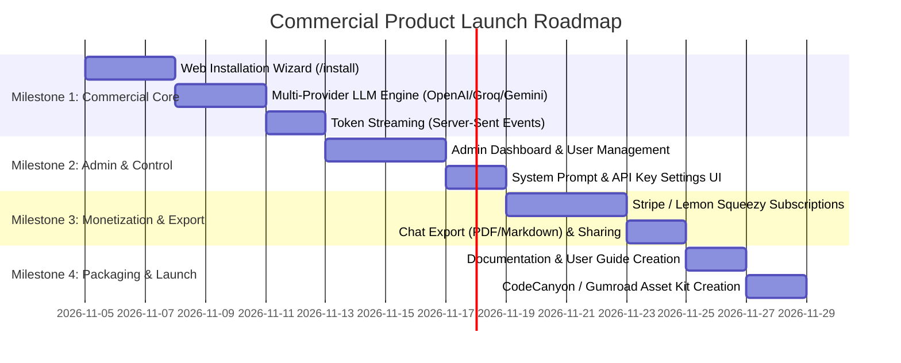

# Commercial Readiness & Product Roadmap Guide
**Product:** Pial Laravel AI Assistant  
**Author:** Pial Mahmud  
**Target Marketplaces:** CodeCanyon (Envato), Gumroad, Lemon Squeezy, or Self-Hosted Micro-SaaS  
**Evaluation Date:** November 2026  

---

## 1. Executive Verdict & Readiness Score

### **Overall Commercial Readiness: 65% (Functional Prototype $\rightarrow$ Pre-Commercial)**

| Dimension | Score | Assessment |
| :--- | :---: | :--- |
| **Core AI Chat Engine** | **85%** | Fast Groq LPU integration, reliable context management, prompt engineering. |
| **UI/UX Aesthetics** | **85%** | Sleek dark/light themes, Lucide icons, responsive drawer, modals, code copy. |
| **Database & Multi-Chat** | **80%** | Full conversation persistence, rename, delete, time-grouped history. |
| **Commercial Packaging / Installer** | **20%** | **Missing.** Requires manual CLI commands; marketplace buyers demand a GUI installer. |
| **Admin Control Panel** | **15%** | **Missing.** No UI to manage users, monitor API keys, or set system configurations. |
| **Multi-Provider LLM Support** | **40%** | Hardcoded to Groq (Llama 3.3). Lacks OpenAI, Gemini, Claude, and DeepSeek toggles. |
| **Streaming Response (SSE)** | **30%** | Synchronous waiting; lacks token-by-token live typewriter streaming. |
| **Monetization & Billing** | **10%** | No Stripe / PayPal / Lemon Squeezy subscription or credit package integration. |

> ### Summary Verdict
> **Is the product ready to sell right now?**  
> **Not quite yet.** While the core chat engine, database architecture, and user interface are solid and attractive, marketplace buyers (especially on CodeCanyon or Gumroad) expect **turnkey software** that anyone can install via a browser wizard without touching the terminal, plus an **Admin Panel** to manage settings and **Multi-LLM provider options**.
>
> With **4 key additions** (Web Installer, Admin Dashboard, Multi-LLM provider support, and Streaming responses), this product can easily sell for **$29 – $49 on CodeCanyon** or as a **$19/month Micro-SaaS**.

---

## 2. Critical Gaps: What is Missing for Commercial Sale

### 2.1 Web-Based Installation Wizard (Priority: Critical)
* **The Problem**: Right now, running the app requires `composer install`, `npm run build`, editing `.env`, setting up an SQLite/MySQL database, running `php artisan migrate`, and generating app keys via the terminal.
* **Market Standard**: 85% of buyers on CodeCanyon are non-developers or agency owners who cannot use SSH/Terminal.
* **What's Needed**:
  * A 4-step web installer at `/install`:
    1. **Server Requirements Check**: PHP 8.2+, SQLite/MySQL, cURL, OpenSSL, BCMath, Mbstring.
    2. **Folder Permissions Check**: `storage/` and `bootstrap/cache/` writable.
    3. **Database Configuration**: Enter DB host, database name, user, and password; auto-runs migrations and seeders.
    4. **Admin Account & API Setup**: Create first Administrator user and input Groq / OpenAI API keys.

---

### 2.2 Admin Dashboard & Configuration Panel (Priority: Critical)
* **The Problem**: All configuration (API keys, models, rate limits, system prompts) is hardcoded or stored in `.env`.
* **What's Needed**:
  * A protected `/admin` area accessible only to users with `role: admin`:
    * **Analytics**: Total users, total chats, daily token usage, API request count.
    * **User Management**: View users, ban/activate accounts, manually adjust credit/quota.
    * **AI Model Settings**: Toggle between Groq, OpenAI (GPT-4o), DeepSeek (V3/R1), and Google Gemini via GUI.
    * **System Persona Settings**: Edit default system instructions without touching code.
    * **Maintenance & Cache**: Clear cache and view logs directly from the browser.

---

### 2.3 Multi-Provider LLM Integration & BYOK (Priority: High)
* **The Problem**: Currently tied solely to Groq. Buyers often have OpenAI credits, want DeepSeek's low cost, or prefer Claude/Gemini.
* **What's Needed**:
  * Implement an AI Provider Factory pattern supporting:
    * **Groq** (Llama 3.3 70B, Mixtral)
    * **OpenAI** (GPT-4o, GPT-4o-mini)
    * **Google Gemini** (Gemini 2.0 Flash)
    * **DeepSeek** (DeepSeek V3, DeepSeek R1 Reasoning)
  * **BYOK (Bring Your Own Key)** option: Allow end-users to input their own API key in user settings if they exceed free tier quotas.

---

### 2.4 Token-by-Token Streaming Responses (Priority: High)
* **The Problem**: The app currently waits synchronously for the full answer (2–5 seconds) before displaying the message.
* **What's Needed**:
  * Implement **Server-Sent Events (SSE)** streaming so words stream in real-time as they are generated by the model (the classic ChatGPT typewriter effect).
  * Drastically improves perceived latency and perceived product quality.

---

### 2.5 File Attachments & Vision / Code Uploads (Priority: Medium)
* **The Problem**: Users can only send text messages.
* **What's Needed**:
  * Attachment button in the prompt bar:
    * Upload `.php`, `.js`, `.json`, `.sql`, or `.txt` code files for analysis.
    * Upload images/screenshots for error debugging (using multimodal models like `llama-3.2-11b-vision` or `gemini-1.5-flash`).

---

### 2.6 Export, Sharing & Audio/Voice Features (Priority: Medium)
* **What's Needed**:
  * **Export Chat**: Download conversation as PDF, Markdown (`.md`), or raw Text.
  * **Share Link**: Generate a public read-only link for a conversation.
  * **Text-to-Speech (TTS)**: Listen to AI responses.

---

### 2.7 Monetization & Payment Gateway (For SaaS or Paid Scripts)
* **What's Needed**:
  * Integrated billing with **Stripe** / **PayPal** / **Lemon Squeezy**:
    * **Free Tier**: E.g., 20 messages/day.
    * **Pro Tier**: Unlimited messages, faster models, file upload support.
    * **Credit Packs**: Buy 100k tokens or 500 prompts.

---

## 3. Product Roadmap to 100% Marketplace Launch

---

## 4. Packaging & Marketplace Selling Strategy

### 4.1 Marketplace Target Platforms

| Platform | Recommended Price | Target Audience | Key Requirement |
| :--- | :---: | :--- | :--- |
| **CodeCanyon (Envato)** | **$29 – $49** (Regular) / **$199** (Extended) | Web developers, freelancers, digital agencies | GUI web installer, auto-updates, Envato purchase code verifier. |
| **Gumroad / Lemon Squeezy** | **$39 – $79** (One-time) | Solo developers, startups, indie hackers | Clean GitHub repo access, comprehensive documentation, setup video. |
| **Turnkey SaaS (Self-Hosted)** | **$9 – $19 / month** per user | Freelancers, dev teams needing shared AI assistance | Stripe/Paddle subscriptions, team workspaces, multi-tenancy. |

---

### 4.2 Essential Deliverables Checklist Before Submitting to Marketplaces

- [ ] **1. One-Click Web Installer**: Fully tested on Shared Hosting (cPanel), VPS, and Docker.
- [ ] **2. Live Demo Website**: Hosted public demo with a test account (e.g. `demo@example.com` / `password123`) with restricted admin capabilities.
- [ ] **3. Comprehensive Documentation**:
  - HTML or GitBook style documentation covering:
    - Server requirements (PHP 8.2+, MySQL 8/MariaDB/SQLite).
    - Step-by-step installation instructions.
    - How to get free API keys from Groq, Google AI Studio, and OpenAI.
    - Troubleshooting common errors (permissions, cron jobs, timeouts).
- [ ] **4. High-Converting Promotional Graphics**:
  - Main Cover Banner (590x300 for CodeCanyon, 1280x720 for Gumroad).
  - Feature Slide Carousels (Dashboard preview, Mobile drawer preview, Markdown code highlighting, Multi-model selector).
- [ ] **5. Video Demonstration**:
  - 90-second YouTube or Loom video showing installation, asking Laravel questions, using the cheatsheet, and dark/light mode toggle.
- [ ] **6. Clean Production Package**:
  - Exclude `.git`, `node_modules`, `.env` (keep clean `.env.example`), test SQLite databases with test data.

---

## 5. Next Steps for Immediate Action

To transition this project from its current state to a sellable, money-making asset, prioritize in this order:

1. **Step 1**: Build the **Web-based GUI Installer (`/install`)** so buyers can install on any hosting with 3 clicks.
2. **Step 2**: Add **Streaming Response (SSE)** to provide the instant typewriter chat experience.
3. **Step 3**: Implement the **Admin Control Panel (`/admin`)** to manage API keys, users, and models.
4. **Step 4**: Prepare documentation and launch marketing assets.
